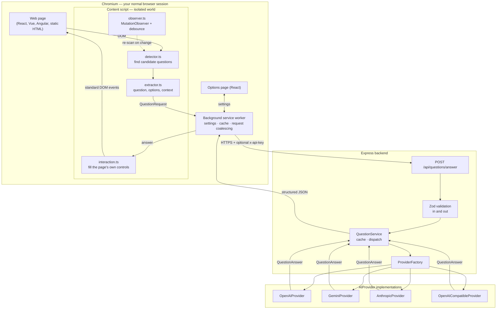
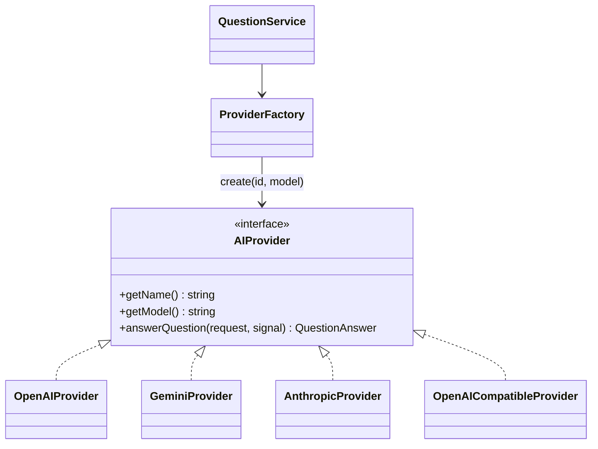

# AI Browser Learning Assistant

A Manifest V3 Chromium extension that reads practice questions out of the page
you are already on, answers them through a configurable AI provider, and — when
you ask it to — fills the answer into the page's own controls.

There is no chat window, no floating panel and no "AI answer" badge. The page
looks exactly as it did before the extension was installed; all of the work
happens in a content script, a background service worker and a small Express
backend.

Built as a learning and portfolio project. It deliberately implements **no**
CAPTCHA solving, anti-bot evasion, proctoring bypass or browser-security bypass,
and it does not disguise itself as anything other than a browser extension.

---

## Contents

- [Architecture](#architecture)
- [Technology stack](#technology-stack)
- [Extension architecture](#extension-architecture)
- [Controlling it](#controlling-it)
- [Monitoring and logs](#monitoring-and-logs)
- [Backend architecture](#backend-architecture)
- [AI provider architecture](#ai-provider-architecture)
- [Persistence](#persistence)
- [Environment configuration](#environment-configuration)
- [Local development](#local-development)
- [Installing the extension](#installing-the-extension)
- [Demo website](#demo-website)
- [API documentation](#api-documentation)
- [Security](#security)
- [Privacy](#privacy)
- [Testing](#testing)
- [Manual testing](TESTING.md)
- [Docker](#docker)
- [Deploying the backend](#deploying-the-backend)
- [Adding a new AI provider](#adding-a-new-ai-provider)
- [Project structure](#project-structure)
- [Future improvements](#future-improvements)

---

## Architecture



Two rules shape the whole design:

1. **The extension only ever talks to your backend.** The backend holds its
   own provider keys; a user who prefers their own account can enter a key in
   the extension's settings, which travels to the backend in a header for each
   request and is never stored or logged there (see
   [Choosing a provider from the extension](#choosing-a-provider-from-the-extension)).
2. **Nothing above the `AIProvider` interface knows which vendor answered.**
   Detection, transport, caching and the UI are all vendor-agnostic.

---

## Technology stack

| Area | Choice |
|---|---|
| Extension | TypeScript, Vite, React (options page only), Manifest V3 |
| Browser APIs | Content scripts, service worker, `chrome.storage`, `chrome.scripting`, `chrome.permissions`, MutationObserver, message passing |
| Backend | Node.js, TypeScript, Express 5, Zod, Helmet, CORS, `express-rate-limit`, pino |
| AI SDKs | `openai`, `@google/genai`, `@anthropic-ai/sdk` |
| Persistence | MongoDB / MongoDB Atlas (optional), official `mongodb` driver |
| Testing | Vitest (jsdom for the extension, node for the backend), Supertest, mongodb-memory-server |
| Tooling | npm workspaces, Docker, Docker Compose |

Persistence is optional. Without `MONGODB_URI` the backend runs entirely in
memory; with it, the answer cache and question history live in MongoDB or
MongoDB Atlas — see [Persistence](#persistence).

---

## Extension architecture

**No browser automation framework is involved.** There is no Selenium,
Puppeteer or Playwright, and no second browser instance. The extension runs in
the browser you are already using.

### Detection

`detector.ts` works bottom-up: it finds the answer controls first (radio
groups, checkboxes, `<select>`, text inputs, textareas) and then walks outwards
to the smallest ancestor that also contains prompt text. The cost is therefore
proportional to the number of answerable things on the page, not to the size of
the page. A second pass handles questions rendered as static text with lettered
options and no controls at all.

Supported shapes, all covered by tests against the demo page:

| Shape | Detected as |
|---|---|
| `<fieldset>` + radios with `<label for>` | `multiple_choice` |
| Label-wrapped radios, no fieldset | `multiple_choice` |
| `<select>` dropdown | `multiple_choice` |
| Static text with `A.` / `B.` / `(c)` options | `multiple_choice` |
| Prompt + `<textarea>` | `short_answer` |
| Prompt + `<pre><code>` listing | `programming` |
| Prompt + MathML / KaTeX / `data-latex` | `mathematical` |

Navigation, headers, footers, asides, adverts, hidden elements and
`aria-hidden` subtrees are excluded before any text is read.

### Extraction

Only the question survives the extraction pipeline:

```
DOM
 ↓  candidate detection
 ↓  prompt text (option labels, controls and their labels removed)
 ↓  options (from labels, <select>, or lettered text lines)
 ↓  context (code listings, maths, and a preceding shared passage)
 ↓  normalisation and length limits
 ↓  fingerprint (content hash)
 ↓  QuestionRequest
```

Maths is read structurally rather than flattened: LaTeX is preferred where the
page exposes it (`data-latex`, `<annotation encoding="application/x-tex">`),
and bare MathML is converted with superscripts, fractions and roots intact, so
`3x²+5x−7` does not arrive as the ambiguous `3 x 2 + 5 x − 7`.

### Dynamic pages

`observer.ts` watches the document with a MutationObserver. Mutations are
filtered to ones that could plausibly introduce a question and then coalesced
into a single scan after a 400 ms quiet period, so a re-rendering SPA does not
turn into a stream of API calls.

### Deduplication

Every question is fingerprinted from its normalised text and options with a
64-bit digest. React and Vue destroy and recreate DOM nodes constantly; the
fingerprint is unchanged by that, so a re-render never produces a second
request. The demo page's "Re-render all questions" button exercises exactly
this, and a test asserts the fingerprints are identical afterwards.

### Background service worker

The worker owns everything the page must not see: settings, the backend URL and
the optional backend key. It also:

- re-validates every message from a content script (content scripts share an
  origin with untrusted page code, so their output is not trusted),
- coalesces concurrent identical questions into one backend call,
- keeps a bounded, expiring answer cache,
- registers content scripts dynamically for origins the user has opted in to.

### Answer application

`interaction.ts` uses ordinary DOM APIs only: `click()` on the real control, the
pointer and mouse events a click is made of, and the native value setter plus
bubbling `input`/`change` events for text fields so React's own listeners see
the change. There is no OS-level input simulation. If no option matches
confidently, it reports `no-match` rather than guessing.

Every selection is **verified**. Component libraries often hide the real input
and listen on a wrapper (or on `mousedown`), or have no input at all and keep
their state in `aria-checked`. When a click does not take, it is retried the
way a user would click — on the topmost element at the centre of the visible
option row, then on its label, then (for ARIA widgets) with Space — each given
a moment to show its effect so a checkbox is never toggled twice. A link or
button inside the row is never clicked. If nothing takes, the outcome is
`not-applied`, and that question is not retried on every rescan.

### Hard-to-reach options

| Shape | How it is handled |
|---|---|
| Unnamed inputs, each buried in its own wrapper component | Grouped by structure: each joins the nearest ancestor holding another option of its kind; options split into columns are rejoined |
| Checkboxes that each carry their own `name` | Same structural grouping |
| `role="radio"` / `role="checkbox"` widgets with no input (Google Forms, Radix, Ionic) | Detected, labelled from `aria-label` / `aria-labelledby` / `<label for>` / own text, state read from `aria-checked` |
| Inputs inside open shadow roots (web components) | Found through every open shadow root; grouping, labels and the prompt search cross the boundary; new shadow roots are observed too |
| Option text in a sibling component rather than a `<label>` | Read from the option's whole row |
| Prompt many wrappers above the options | The climb continues up to 12 levels for option groups, but never into another question's options |
| Questions in same-origin iframes | The content script runs in every frame of an enabled site |

Closed shadow roots are out of reach by design.

### Several correct answers

A checkbox group is sent with `multiSelect: true` (as is a text-only question
whose prompt says "select all that apply"). The model is asked for every
correct option in an `answers` list; the backend aligns each entry to an
option, and the content script ticks each one. Boxes are only ever ticked,
never unticked — the group may hold the user's own choices.

---

## Controlling it

### Toolbar popup

Clicking the extension icon opens a small panel that is the day-to-day
control surface:

- **Pause / Resume.** A global stop. While paused nothing is answered on any
  tab, and the toolbar badge shows `||`.
- **Enable on this site.** Requests host access for the site you are looking
  at and starts working on it immediately — no reload, no visit to the options
  page. The same button disables and revokes it again.
- Counters for today and all time, and whether answer filling is on.

### Timing

Both delays live under **Settings → Timing**, as presets with a custom box:

| Setting | What it does |
|---|---|
| **Start answering** | How long to wait after resuming before the first answer. Counted from when you press Resume, so you can open a page and read it yourself first. The popup shows a live countdown and the badge shows `…`. |
| **Delay between answers** | Minimum gap between two answers, enforced **globally** rather than per tab — three pages open at once still produce one answer per interval. |

Questions found while the start delay is still running are not lost: the
content script is told to retry, and picks them up the moment it elapses.

### One question per page

Sites that show a single question and make you click **Next** are handled
without any special configuration:

- A full page load starts a fresh content script, which finds the new question.
- A single-page app that swaps the question in place is caught by the
  MutationObserver.
- Navigating **back** to a question that was already answered re-fills it from
  the in-page answer map, with no second request.

**It fills answers in and stops there.** It never clicks Next, Submit, Finish
or any other control — advancing through a quiz is yours to do.

---

## Monitoring and logs

The options page opens on a **Monitor** tab showing live run state, a countdown
when the start delay is running, counters (today, total, cached, errors), the
backend it is pointed at with a one-click health check, a feed of recent
questions, and which sites have been busiest.

The **Activity log** tab is the full record — one row per question with time,
site, question, answer, outcome and latency. Rows expand for the detail
(type, option count, provider, model, page). It can be filtered by outcome,
searched across questions, answers and sites, exported as JSON for a bug
report, and cleared.

Outcomes are recorded end to end, including what happened on the page itself:
`answered`, `cached`, `filled`, `no match` (the answer did not match any option
confidently, so nothing was touched), `nothing to fill` and `error`.

The log lives in `chrome.storage.local`, is capped (500 entries by default,
oldest dropped first), and is never transmitted anywhere. Recording can be
switched off entirely under **Settings → Activity log**. This local log is
separate from the backend's own question history, which exists only when the
backend has MongoDB configured — see [Persistence](#persistence).

### This browser or the server

Both tabs have a **This browser | Server** switch, remembered between visits:

| | This browser | Server |
|---|---|---|
| Source | `chrome.storage.local` | the backend's `/api/history` and `/api/stats` |
| Covers | this browser only | every browser and device using the backend |
| Outcomes | all, including `filled`, `no match` and `error` | `answered` and `cached` only — the server never sees the page |
| Fourth counter | errors | average response time |
| Kept | last 500 entries | `HISTORY_RETENTION_DAYS` (default 90) |
| Monitor refresh | every 4 s | every 30 s, to stay well inside the backend's rate limit |

The server view loads 100 entries at a time with **Load older**, and **Clear**
asks for a second click before deleting anything from the server. If the
backend keeps no history, or rejects the API key, the tab says so rather than
showing an empty list. **Check now** on the Monitor also reports the backend's
storage: whether MongoDB is connected, where the cache lives and whether
history is on.

---

## Interface

The options page is laid out as an admin console: a fixed sidebar for
navigation, a sticky header carrying the page title and its actions, and
panelled content with dense data tables.

It is deliberately **monochrome** - every colour in the stylesheet is a true
neutral grey, verified by an audit of the compiled CSS. State, emphasis and
severity are carried by fill weight, border style and a leading glyph rather
than by hue, which is also what keeps them legible in high contrast and to
anyone who could not rely on colour in the first place:

| Outcome | Rendered as |
|---|---|
| answered | outlined chip, tick |
| filled | solid grey chip, tick |
| cached | soft filled chip, repeat glyph |
| no match | dashed outline, question mark |
| nothing to fill / skipped | faint outline, dash |
| error | solid black chip, exclamation |

Run state uses the same idea: a filled dot for running, a dashed ring while
the start delay counts down, and a hollow ring when paused or switched off.

Light and dark both follow the system preference.
---

## Backend architecture

```
Express
 ├── helmet, CORS (wildcard-aware), JSON body limit
 ├── GET  /api/health              (unauthenticated, for the options page)
 └── /api  → x-api-key auth → rate limit
      ├── POST /questions/answer   → QuestionService → ProviderFactory → AIProvider
      │                                   ↘ AnswerStore (memory | MongoDB)
      │                                   ↘ HistoryStore (off | MongoDB)
      ├── POST /providers/test     → one fixed question, no cache, no history
      ├── POST /cache/clear
      ├── GET  /history, GET /stats
      └── POST /history/clear
```

- **Zod validates both directions.** A provider that returns something
  off-contract is reported as a provider failure (502), never passed through.
- **One error vocabulary.** Every SDK's exceptions are translated into a
  `ProviderError` with a code (`authentication`, `rate_limited`, `timeout`,
  `unavailable`, `invalid_response`, `missing_credentials`, `bad_request`) that
  maps to a fixed HTTP status and a `retryable` flag.
- **Timeouts are enforced locally**, so a provider that stops responding cannot
  hold an Express request open. A client that disconnects aborts the provider
  call with it.
- **The cache is an interface** (`AnswerStore`) with an in-memory LRU and a
  MongoDB implementation, chosen at startup; Redis would slot in the same way.
  A cache that fails mid-request costs a provider call, never the answer.

---

## AI provider architecture

Every vendor sits behind one interface:

```ts
interface AIProvider {
  getName(): string;
  getModel(): string;
  answerQuestion(request: QuestionRequest, signal?: AbortSignal): Promise<QuestionAnswer>;
}
```



All four adapters build their prompt from the same `question.prompt.ts`, so
switching provider changes who answers, not what was asked.

| Provider | Id | How output is constrained | Default model |
|---|---|---|---|
| OpenAI | `openai` | Chat Completions with a strict `json_schema` | `gpt-4o-mini` |
| Google Gemini | `gemini` | `responseMimeType` + JSON schema | `gemini-3.5-flash` |
| Anthropic Claude | `anthropic` | Structured outputs (`messages.parse`) validated against the shared Zod schema | `claude-opus-5` |
| OpenAI-compatible | `openai-compatible` | JSON object mode, schema restated in the prompt, lenient parse as a fallback | from `AI_MODEL` |

Defaults are a starting point, not a recommendation — set `AI_MODEL`, or send
`model` with a request, to use anything else. `AI_MODEL` applies to
`AI_PROVIDER` only (and to the server's own OpenAI-compatible endpoint), so
switching provider in the extension never sends one vendor's model name to
another.

### Choosing a provider from the extension

**Settings → AI provider** picks the provider and model, and optionally takes
**your own API key** (plus the base URL, for an OpenAI-compatible endpoint
such as OpenRouter, Ollama or LM Studio). **Test provider** sends one small
question through the backend with the settings as they are on screen, saved
or not, and shows the model's answer and latency — or the provider's error.

| Leave the key blank | Enter a key |
|---|---|
| The backend's key from `server/.env` is used | Your key is used for your requests, in place of the backend's |

How the key is handled:

- Stored in `chrome.storage.local` on this device only — never synced through
  the browser profile like the other settings — and never handed to a content
  script (both keys are blanked out of anything a page-side script receives).
- Sent only to your backend, as the `x-ai-api-key` header (`x-ai-base-url` for
  an OpenAI-compatible endpoint), never in the request body.
- The backend uses it to build that request's adapter and nothing else: it is
  not cached, not written to history, and pino redacts the header.
- With "Use the backend's configured provider" selected, no key is sent.
- A key for an OpenAI-compatible endpoint is only ever sent to the base URL
  that came with it, never to the server's own `AI_BASE_URL`.

A backend operator who does not want this sets `ALLOW_CLIENT_AI_KEYS=false`:
requests carrying a key are then refused with a clear message, and the
settings page warns about it. On a hosted backend, keep `API_ACCESS_KEY` set —
a user-supplied OpenAI-compatible base URL makes the server call that URL.

The Claude adapter checks `stop_reason` before reading content, so a safety
refusal (which arrives as HTTP 200) becomes a clear error rather than a parse
failure. Server-side refusal fallbacks are a natural extension point there if
you want automatic re-routing.

---

## Persistence

Set `MONGODB_URI` in `server/.env` and the backend keeps two collections:

| Collection | What it holds | Expiry |
|---|---|---|
| `answer_cache` | One answer per question + options + context + provider + model | `CACHE_TTL_MS` (default 30 min), via a TTL index |
| `question_history` | Question, type, options, answer, explanation, confidence, provider, model, cached flag, latency, page **origin** | `HISTORY_RETENTION_DAYS` (default 90), via a TTL index |

Why it matters once the backend is hosted: the cache survives restarts and
redeploys and is shared by every instance, and history and usage statistics
exist somewhere other than one browser's `chrome.storage.local`.

| `MONGODB_URI` | `CACHE_ENABLED` | `HISTORY_ENABLED` | Cache | History |
|---|---|---|---|---|
| unset | true | (ignored) | memory | off |
| set | true | true | MongoDB | on |
| set | true | false | MongoDB | off |
| set | false | true | off | on |

- **Startup fails if `MONGODB_URI` is set but unreachable**, with the reason —
  silently falling back to memory would lose history without anyone noticing.
  Unset it to run without persistence.
- **Atlas:** use the `mongodb+srv://` string from *Connect → Drivers*, put the
  database name in the path (`…mongodb.net/quiz-shop?…`), and add the
  server's outbound IP under *Network Access*.
- **`querySrv ECONNREFUSED`** means the machine's DNS resolver refused the SRV
  lookup `mongodb+srv://` needs, which some VPNs and endpoint agents do. Set
  `MONGODB_DNS_SERVERS=8.8.8.8,1.1.1.1`; it changes only the driver's SRV/TXT
  lookups.
- `GET /api/health` reports `persistence.database` as `connected`,
  `unreachable` (status becomes `degraded`) or `not_configured`.

---

## Environment configuration

Copy `server/.env.example` to `server/.env` and fill in the provider you want.
A blank value means "not set", so unused keys can be left empty.

```bash
AI_PROVIDER=openai          # openai | gemini | anthropic | openai-compatible
AI_MODEL=                   # optional override; required for openai-compatible

OPENAI_API_KEY=
GEMINI_API_KEY=
ANTHROPIC_API_KEY=

AI_BASE_URL=                # any OpenAI-compatible endpoint
AI_API_KEY=

ALLOW_CLIENT_AI_KEYS=true   # use a key entered in the extension's settings

PORT=3000
```

The full list — CORS origins, rate limits, timeouts, body size, cache settings,
the `API_ACCESS_KEY` shared secret and the MongoDB settings — is
documented inline in `server/.env.example`.

**The backend's API keys stay on the backend.** They are never bundled into the
extension, never sent to the page, never returned by `/api/health` and never
logged. A user can still bring their own key from the extension's settings —
see [Choosing a provider from the extension](#choosing-a-provider-from-the-extension).

---

## Local development

### One click (Windows)

Double-click **`Start Quiz Assistant.bat`**. The first run checks for
Node.js 20+, installs dependencies, builds the backend and the extension,
creates `server/.env` from the example, copies the `extension\dist` path to
the clipboard and opens Chrome's extensions page for **Load unpacked**. Every
run then starts the backend in that window — keep it open, close it to stop.
Run `"Start Quiz Assistant.bat" rebuild` after changing or updating the code.
No key is needed in `server/.env`: enter one in the extension's settings.

### By hand

```bash
npm install          # installs both workspaces

npm run dev          # backend on http://localhost:3000 (watch mode)
npm run demo         # demo quiz site on http://localhost:5173
npm run build:extension   # writes extension/dist
```

Per workspace:

```bash
cd server     && npm run dev     # tsx watch
cd extension  && npm run dev     # both Vite builds in watch mode
cd extension  && npm run build   # production build into dist/
```

Other root scripts: `npm test`, `npm run typecheck`, `npm run build`.

### Running the whole stack without an API key

`npm run fake-ai` starts a tiny local OpenAI-compatible endpoint that answers
every question deterministically. Point the backend at it and the full path —
detection, message passing, backend, provider adapter, validation, caching,
answer filling — runs with no credentials at all:

```bash
# server/.env
AI_PROVIDER=openai-compatible
AI_BASE_URL=http://127.0.0.1:4999/v1
AI_API_KEY=local-dev
AI_MODEL=fake-model
```

```bash
npm run fake-ai   # terminal 1
npm run dev       # terminal 2
npm run demo      # terminal 3
```

It always picks the second option, so you can see at a glance whether the
answer reached the page.

---

## Installing the extension

1. `npm run build:extension` (or `npm run dev:extension` while developing).
2. Open `chrome://extensions`.
3. Turn on **Developer mode**.
4. Click **Load unpacked** and select `extension/dist`.
5. Open the extension's **Details → Extension options** to configure it.

The extension ships with access to `localhost` only, so the demo works
immediately. To use it on another site, add that site in the options page —
Chrome will prompt for host access, and the worker then registers a content
script for it. Remove the site to revoke access.

---

## Demo website

`npm run demo` serves `demo/` on <http://localhost:5173> with no dependencies.
It exists so the whole project can be demonstrated without depending on anyone
else's site.

It contains seven questions in deliberately different DOM shapes, plus:

- **Load two more questions** — inserts questions ~900 ms after load, so the
  MutationObserver path is exercised rather than the initial scan.
- **Re-render all questions** — destroys and rebuilds every question node the
  way a React re-render does; the extension should recognise them and stay
  quiet.
- Navigation, an advert block and a footer, all containing question-shaped text
  that must be ignored.

---

## API documentation

### `POST /api/questions/answer`

Headers: `Content-Type: application/json`, plus `x-api-key` when
`API_ACCESS_KEY` is configured. Optionally `x-ai-api-key` — the caller's own
provider key, used for this request in place of the server's — and, with
`provider: "openai-compatible"`, `x-ai-base-url` (a `model` is then required).

```json
{
  "question": "What is the time complexity of binary search?",
  "type": "multiple_choice",
  "options": ["O(n)", "O(log n)", "O(n²)", "O(1)"],
  "context": "optional supporting code, maths or passage",
  "source": { "url": "https://example.com/quiz", "title": "Practice quiz" },
  "multiSelect": false,
  "provider": "anthropic",
  "model": "claude-opus-5"
}
```

Only `question` is required. `type` defaults to `unknown`; `provider` and
`model` override the server defaults for that one request. `multiSelect: true`
says more than one option may be correct; the answer then carries
`"answers": ["…", "…"]` (each an option's exact text) and `answer` is the same
list joined with `"; "`.

```json
{
  "data": {
    "answer": "O(log n)",
    "explanation": "Binary search repeatedly halves the search space.",
    "confidence": 0.97,
    "reasoningSummary": "Standard complexity result for a halving search.",
    "provider": "openai",
    "model": "gpt-4o-mini"
  },
  "meta": { "cached": false }
}
```

`reasoningSummary` is a short learner-facing note. No provider is asked for, and
none returns, raw chain-of-thought.

### `GET /api/health`

```json
{
  "status": "ok",
  "uptimeSeconds": 42,
  "activeProvider": "openai",
  "providers": ["openai"],
  "allProviders": [{ "id": "openai", "label": "OpenAI", "configured": true, "defaultModel": "gpt-4o-mini" }],
  "clientCredentials": true,
  "persistence": { "database": "connected", "cache": "mongodb", "history": true }
}
```

`clientCredentials` says whether a key sent from the extension will be used
(`ALLOW_CLIENT_AI_KEYS`).

### `POST /api/providers/test`

Body `{ "provider"?: "...", "model"?: "..." }`, with the same optional
`x-ai-api-key` / `x-ai-base-url` headers. Asks that provider one fixed
question, bypassing cache, retries and history, and returns
`{ "data": { "provider", "model", "answer", "latencyMs" } }` — or the provider's
error with its usual status. The settings page's **Test provider** button.

### `POST /api/cache/clear`

Empties the backend answer cache. Returns `{ "data": { "cleared": true } }`.

### `GET /api/history?limit=25&before=<ISO date>`

Newest first. `limit` is 1–100 (default 25); pass `data.nextBefore` back as
`before` for the next page.

```json
{
  "data": {
    "entries": [
      {
        "id": "6ab6379dfa5d4668c71ca91d",
        "createdAt": "2026-09-25T08:58:05.596Z",
        "question": "Which data structure uses FIFO ordering?",
        "type": "multiple_choice",
        "options": ["Stack", "Queue", "Tree", "Heap"],
        "answer": "Queue",
        "explanation": "…",
        "confidence": 0.92,
        "provider": "openai",
        "model": "gpt-4o-mini",
        "cached": false,
        "latencyMs": 812,
        "origin": "https://quiz.example.com"
      }
    ],
    "nextBefore": "2026-09-25T08:58:05.596Z"
  },
  "meta": { "enabled": true }
}
```

`meta.enabled` is `false` when history is not kept (no `MONGODB_URI`, or
`HISTORY_ENABLED=false`), so an empty list can be told apart from "off".

### `GET /api/stats`

```json
{
  "data": {
    "total": 120, "today": 14, "cached": 31, "averageLatencyMs": 640,
    "byProvider": [{ "provider": "openai", "model": "gpt-4o-mini", "count": 120 }],
    "byType": [{ "type": "multiple_choice", "count": 96 }],
    "topOrigins": [{ "origin": "https://quiz.example.com", "count": 80 }]
  },
  "meta": { "enabled": true }
}
```

### `POST /api/history/clear`

Deletes all history. Returns `{ "data": { "cleared": true, "deleted": 120 } }`.

History and stats sit behind the same `x-api-key` and rate limit as answering.

### Errors

Every failure uses the same envelope:

```json
{ "error": { "code": "rate_limited", "message": "…", "provider": "openai", "retryable": true } }
```

| Status | Code | Meaning |
|---|---|---|
| 400 | `invalid_request` / `invalid_json` / `bad_request` | The request was malformed |
| 401 | `unauthorized` | `x-api-key` missing or wrong |
| 403 | `origin_not_allowed` | CORS origin rejected |
| 413 | `payload_too_large` | Body over `MAX_REQUEST_BODY` |
| 429 | `rate_limited` | Local rate limit, or the provider's |
| 502 | `authentication` / `invalid_response` | Provider rejected us, or broke the contract |
| 503 | `missing_credentials` / `unavailable` | Provider not configured, or down |
| 504 | `timeout` | Provider exceeded `PROVIDER_TIMEOUT_MS` |

---

## Security

Implemented:

- Helmet, explicit CORS allow-list (with a trailing-wildcard form so the
  development extension id does not have to be pinned), rate limiting, Zod
  validation on input and output, and a request body size limit.
- Shared-secret authentication, compared in constant time — optional in
  development, required when `NODE_ENV=production` (the server will not start
  without it).
- Server keys stay server-side; never in the extension bundle, never logged —
  pino redacts `authorization`, `x-api-key`, `x-ai-api-key` and `cookie`.
  A user's own key lives in the extension's local storage, is never given to a
  content script, and is used by the backend for that request only.
- No `eval`, no `new Function`, no remote code, no page-supplied JavaScript
  executed, no CSP relaxation. The extension declares its own restrictive CSP.
- Messages from content scripts are re-validated in the service worker, and
  `settings:save` is refused if it arrives from a tab.
- Page text is fenced into labelled blocks in the prompt and the system prompt
  states that page content is data, not instructions, so a page containing
  "ignore previous instructions" is quoted material rather than a command.

Deliberately **not** implemented: CAPTCHA solving, anti-bot evasion, proctoring
bypass, browser-security bypass, or anything that manipulates automation
detection. The project works because it is a browser extension, not because it
is pretending not to be one.

---

## Privacy

The extension sends the smallest thing that can answer the question:

```
relevant DOM content → question extraction → minimal context → backend → AI provider
```

What is transmitted, and nothing else:

| Field | Contents |
|---|---|
| `question` | The prompt text, with option labels and numbering removed |
| `options` | The answer options, when the question has any |
| `context` | Code, maths or a shared passage from the same container, capped by **Maximum context length** (default 2000 characters, `0` disables it entirely) |
| `source` | Page URL and title |

The full page is never sent. Navigation, adverts and footers are excluded
before extraction. Settings live in `chrome.storage.sync`, except your own
provider key, which stays in this device's `chrome.storage.local`.

**What the backend stores depends on `MONGODB_URI`.** Without it, nothing is
written anywhere: the answer cache is in memory and expires. With it, cached
answers (30 minutes by default) and question history (90 days by default) are
stored in your MongoDB database. History keeps the question, options, answer
and the page's **origin** only — never the page context, the full URL or the
page title. Turn it off with `HISTORY_ENABLED=false`, shorten it with
`HISTORY_RETENTION_DAYS`, or wipe it with `POST /api/history/clear`.

**The AI provider you select will process the question and context you send.**
That is inherent to the design — choose the provider accordingly, and set
maximum context length to `0` if you would rather send nothing but the question.

---

## Testing

```bash
npm test                      # both workspaces
npm run test:coverage         # with a coverage report
npm test --workspace @ai-browser-assistant/server
npm test --workspace @ai-browser-assistant/extension
```

**185 tests**, no network access and no credentials required.

| Area | Tests | What they cover |
|---|---|---|
| `detector.test.ts` | 15 | Every question shape on the real `demo/index.html`; option extraction from each markup style; type classification; ignoring navigation, adverts and footers; stable fingerprints across a re-render; pages with no questions (prose, a login form, an empty document) |
| `content.test.ts` | 22 | Normalisation, fingerprinting, MathML conversion, option matching, answer application into radios, selects and text fields |
| `observer.test.ts` | 11 | Debounce coalescing, mutation filtering, the attribute allow-list, start/stop, scan-on-demand |
| `content-script.test.ts` | 14 | The content script driven end to end in a fake page: what it sends, deduplication across a re-render, auto-fill on and off, that it adds no UI, retry on network failure, and ignoring a message the page forged |
| `messaging.test.ts` | 17 | The round trip through the real service worker: content script → worker → backend → worker → content script, worker-side re-validation, refusing `settings:save` from a tab, request coalescing, cache hits, settings broadcast, dynamic script registration |
| `options.test.tsx` | 13 | The options page rendered for real: loading and saving settings through the worker, connection test, cache clearing, and host-permission requests from a genuine click |
| `demo.test.ts` | 3 | The demo page's own script plus the detector: late-arriving questions found, re-renders producing identical fingerprints |
| `api.test.ts` (server) | 30 | The endpoint with a stub provider: valid requests, missing/short question, oversized context and body, malformed JSON, unknown provider, per-request overrides, every provider error code and its status, caching, cache clearing, the shared secret, rate limiting, CORS |
| `providers.test.ts` (server) | 41 | All four adapters against a **stubbed `fetch` with the real SDKs** — success, 401, 429, 5xx, connection failure, timeout, truncated output, malformed JSON, Claude's refusal stop reason, and the factory's credential checks |

Coverage: **87% of statements** in the extension, **84%** in the backend.

Testing the adapters through the real SDKs rather than mocking them is
deliberate: the part most likely to break when a dependency moves is the
translation of each SDK's own error types, and a mock would assert nothing
about that.

### Testing it by hand

Everything the suite cannot reach - loading into Chrome, the demo page, failure
handling, a real provider - is a stage-by-stage checklist in
[TESTING.md](TESTING.md).

### Not covered by the suite

- `server/src/index.ts` — process bootstrap and signal handling; exercised by
  running it, not by a unit test.
- `extension/src/options/main.tsx` — the four-line React root mount.
- **Loading the extension into Chrome.** `chrome://extensions` cannot be
  driven by automation, so *Load unpacked* is a manual step.
- **Live provider calls.** No test spends money or needs a key. Point the
  backend at `npm run fake-ai` to exercise the real HTTP path.

---

## Docker

```bash
docker compose up                        # backend (uses Atlas if MONGODB_URI is set)
docker compose --profile persistence up  # backend + a local MongoDB
```

For the local MongoDB, set `MONGODB_URI=mongodb://mongo:27017/quiz-shop` in
`server/.env`. Compose runs the backend with `NODE_ENV=production`, so
`API_ACCESS_KEY` must be set.

The image is a multi-stage build that runs as the non-root `node` user and has
a health check against `/api/health`. It reads `server/.env`.

Docker is never required for development — `npm run dev` is enough.

---

## Deploying the backend

With persistence in MongoDB Atlas the backend holds no state of its own, so
any host that runs a container or a Node process will do: Render, Railway,
Fly.io, Cloud Run, a VPS.

1. **Build:** `docker build -f server/Dockerfile .` from the repository root,
   or on a Node host `npm ci && npm run build:server` then
   `node server/dist/index.js`.
2. **Environment** (the host's secret settings, not a committed file):

   | Variable | Value |
   |---|---|
   | `NODE_ENV` | `production` — binds `0.0.0.0`, CORS defaults to `chrome-extension://*` |
   | `API_ACCESS_KEY` | a long random string — **required** in production |
   | `AI_PROVIDER` + that provider's key | e.g. `openai` + `OPENAI_API_KEY` |
   | `MONGODB_URI` | your Atlas connection string |
   | `CORS_ALLOWED_ORIGINS` | optional; pin `chrome-extension://<id>` once the extension id is fixed |
   | `PORT` | usually injected by the host |

3. **Atlas:** add the host's outbound IP under *Network Access* (or
   `0.0.0.0/0` on hosts without a stable IP, which leaves the database
   password as the only guard — use a strong one).
4. **Health check:** point the host at `GET /api/health`.
5. **Extension:** in **Settings → Backend**, set the URL to the deployed
   `https://…` address and the API key to `API_ACCESS_KEY`, then **Test
   connection**.

`trust proxy` is set to one hop, which matches a single load balancer in front
of the app; the rate limiter uses the forwarded client address.

---

## Adding a new AI provider

Four steps, none of which touch the detector, the extension or the transport:

1. Write `server/src/providers/<vendor>.provider.ts` implementing `AIProvider`.
   Build the prompt with `buildUserPrompt`, and translate the SDK's errors into
   `ProviderError`.
2. Add the id to `providerIdSchema` in `question.schema.ts`.
3. Register it in `REGISTRY` in `provider.factory.ts` (label, default model,
   credential check, builder).
4. Add its credentials to `envSchema` in `config/env.ts` and to `.env.example`.

The options page picks the new provider up from `PROVIDER_LABELS` in
`extension/src/shared/constants.ts`.

---

## Project structure

```
ai-browser-assistant/
├── extension/
│   ├── src/
│   │   ├── content/      detector, extractor, observer, interaction, normalize
│   │   ├── background/   service-worker, settings, cache, backend-client
│   │   ├── options/      React options page
│   │   └── shared/       types, messages, constants
│   ├── public/           manifest.json, icons
│   └── tests/
├── server/
│   ├── src/
│   │   ├── controllers/  question, health, history
│   │   ├── question/     schema, prompt, service
│   │   ├── providers/    interface, factory, four adapters, errors
│   │   ├── cache/        AnswerStore: in-memory LRU, MongoDB
│   │   ├── history/      HistoryStore: question history + usage stats
│   │   ├── db/           MongoDB connection, persistence wiring
│   │   ├── middleware/   security, error handling
│   │   ├── config/       env, logger
│   │   └── app.ts
│   ├── tests/
│   ├── Dockerfile
│   └── .env.example
├── demo/                 local practice quiz site
├── scripts/              dependency-free static server for the demo
├── docker-compose.yml
└── package.json          npm workspaces root
```

---

## Future improvements

- **More persistence.** Practice sessions, saved explanations and synced user
  preferences, on the same MongoDB connection.
- **Redis cache**, behind the same `AnswerStore` interface.
- **Streaming answers** to the service worker for long explanations.
- **A popup** showing the answers found on the current page, for when you want
  to read the explanation rather than fill the form.
- **Per-site extraction profiles** for practice sites with unusual markup.
- **Provider comparison mode** — ask two providers and show where they differ,
  which the shared prompt builder already makes meaningful.
